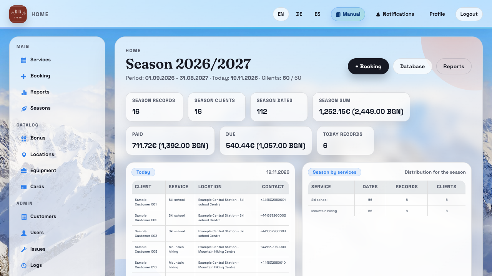

# RIN Laravel CRM

RIN gives ski-school staff one place to manage customer records, reserve places in dated activities, track outstanding payments, and coordinate transport and equipment. Staff use role-specific views for operations, reporting, and administration.



[Customer list](docs/screenshots/customers.png) · [Mobile navigation](docs/screenshots/mobile-navigation.png)

Screenshots show the isolated synthetic demo.

## Run the demo

You need Git, access to the repository, and a running Docker installation with the Compose plugin. Check that `docker compose up --help` lists `--wait`. Allow internet access for the clone, base images, and dependency downloads, and keep local port 8081 free.

Docker supplies PHP, Composer, Node.js, and MySQL. You can start the demo without installing them on the host or creating a local `.env` file.

```sh
git clone https://github.com/zhan94/rin_laravel.git
cd rin_laravel
docker compose -p rin-laravel-demo -f compose.yaml up --build --detach --wait
docker compose -p rin-laravel-demo -f compose.yaml exec -T app sh -c 'cat /run/rin/demo-password && printf "\n"'
```

Open [localhost:8081](http://localhost:8081) and sign in as `demo.super_admin` using the generated password. The same local password works for `demo.admin`, `demo.manager`, `demo.group_leader`, and `demo.driver`. Each role has a different access level.

Compose installs locked dependencies, builds the frontend, generates the key and passwords, and migrates and seeds its own MySQL database. A fresh demo includes five core services, 40 pickup routes, 60 synthetic customers, and 22 bookings. On ARM64 Docker Desktop, a fresh-volume demo reached the sign-in page in about **99 seconds with a fresh build cache** and **13 seconds with a warm cache**. Both runs reused the existing Docker image store and excluded Docker setup. First-time image downloads and slower machines can add time. [Startup measurements](docs/operations.md) · [Core catalog mapping](docs/operations.md#core-business-seeding) · [Native installation](docs/operations.md#native-laravel-setup)

### Evaluate the app in 5–10 minutes

1. Sign in as `demo.manager` and select **EN** to follow the labels below. Open **Home** to see the dashboard's season totals and today's bookings.
2. In **Customers**, search for `Customer 060` to find **Sample Customer 060**. In **Services**, find **Mountain walks** and open **Availability** for a date with places left. Note the remaining places.
3. Open **Booking**, enter `060`, and select **Sample Customer 060** from the suggestions. Book **Mountain walks** for the same date with **Market Square** as the pickup point. Check that **Records** shows the new booking and that **Availability** shows one fewer place.
4. In **Reports**, select **Mountain walks** and the booking date, then select **Generate**. Find the customer in the result. For a role comparison, open the same report as `demo.driver` and check that private fields such as birth date are hidden.
5. As `demo.manager`, cancel the new booking from **Records**. Check that its status is **Cancelled** and the place is available again.

### Startup troubleshooting

- **Compose cannot connect.** Start Docker Desktop or the Docker Engine and run `docker info` and `docker compose version`.
- **Port 8081 is in use.** Prefix the demo startup command with `RIN_LARAVEL_PORT=8083` and open [localhost:8083](http://localhost:8083). Use the same port override each time you start this project.
- **Startup reports an error.** Run `docker compose -p rin-laravel-demo -f compose.yaml ps -a` and `docker compose -p rin-laravel-demo -f compose.yaml logs --tail=100 app` from the checkout.
- **Sign-in fails.** Open the `localhost` URL for the correct project and port, then reread that project's generated password. A reset generates a new one.

### Stop or reset the demo

Use `docker compose -p rin-laravel-demo -f compose.yaml down` to shut down and keep the database, credentials, uploads, and logs.

**Data loss warning.** The reset below permanently deletes the standard demo's database, generated credentials, uploads, and logs. Confirm the project and its volumes first. Use it only when these records can be discarded. The reset targets the named standard demo and its four volumes. The benchmark and host databases are outside that scope.

```sh
docker compose -p rin-laravel-demo -f compose.yaml ps -a
docker volume ls --filter label=com.docker.compose.project=rin-laravel-demo
```

```sh
docker compose -p rin-laravel-demo -f compose.yaml down --volumes
docker compose -p rin-laravel-demo -f compose.yaml up --build --detach --wait
docker compose -p rin-laravel-demo -f compose.yaml exec -T app sh -c 'cat /run/rin/demo-password && printf "\n"'
```

## Run the relational benchmark

The optional benchmark can run alongside the standard demo. It seeds 100,000 customers, 100 services, and 150,000 bookings with their dates, payments, and rental relationships. The projects have separate ports, MySQL databases, Compose networks, named volumes, generated credentials, and session cookies.

```sh
RIN_LARAVEL_PORT=8082 docker compose -p rin-laravel-benchmark -f compose.yaml -f compose.benchmark.yaml up --build --detach --wait --wait-timeout 300
docker compose -p rin-laravel-benchmark -f compose.yaml -f compose.benchmark.yaml exec -T app sh -c 'cat /run/rin/demo-password && printf "\n"'
docker compose -p rin-laravel-benchmark -f compose.yaml -f compose.benchmark.yaml exec -T app php scripts/verify-synthetic-dataset.php
```

Open [localhost:8082](http://localhost:8082) and use the same staff usernames with the benchmark password. Keep the project name and both Compose files when running benchmark commands. To stop it and keep its volumes, run `docker compose -p rin-laravel-benchmark -f compose.yaml -f compose.benchmark.yaml down`. For an untouched standard demo, run `docker compose -p rin-laravel-demo -f compose.yaml exec -T app php scripts/verify-synthetic-dataset.php` to check its data and measure the same operations. [Dataset counts, timings, and measurement method](docs/operations.md#relational-dataset-verification)

## Features and architecture

- Staff authentication and account administration, with Super Admin, Admin, Manager, Group Leader, and Driver roles.
- Customer search and pagination, multi-date bookings with capacity checks, and payment applications and corrections.
- Separate service-season entries with daily capacity and availability, pickup locations, cards, equipment, and bonus services.
- Seasonal dashboard, role-scoped reports, CSV and print output, a staff notification API, and issues with private attachments.

The application uses PHP 8.5, Laravel 12, MySQL 8.4, Fortify, Sanctum, Inertia 2, Vue 3, TypeScript, Tailwind CSS 4, and Vite 7. Form Requests validate input, and middleware and policies enforce staff access. Booking and payment services own their transaction boundaries. Row locks protect capacity and balances, and request receipts make supported retries safe. Report repositories keep role-aware queries together. Logs and notifications use Laravel's concrete injection and share their row filters across reads and writes. [Architecture and trade-offs](docs/architecture.md) · [Final architectural review](docs/architectural-review.md)

The interface defaults to German. The language switcher and staff manual support [Deutsch](http://localhost:8081/manual/de), [English](http://localhost:8081/manual/en), and [Español](http://localhost:8081/manual/es). Dates display as DD.MM.YYYY.

## Verify the application

```sh
sh scripts/ci-verify.sh quality
```

This runs the GitHub Actions quality gate locally, including locked dependency audits, static analysis, PHP and frontend tests, and Chromium on an isolated synthetic demo. The separate MySQL race harness verifies booking and payment contention using independent processes. GitHub Actions also scans source and Git history for secrets. [Test and benchmark commands](docs/operations.md)

The relational MySQL benchmark measured a 3.7 ms median for the first customer page, 20.2 ms for page 3,900, and 83.9 ms for a customer search on ARM64. Booking search, availability, dashboard, and report timings are recorded in the operations guide. [Full benchmark results](docs/operations.md#relational-dataset-verification)

Deep customer pages use offset pagination, and full report exports assemble server pages in the browser. Docker installation was verified on ARM64 and with AMD64 emulation on Docker Desktop. Native AMD64 hardware, hosted CI, physical passkeys, and full accessibility conformance remain outside those checks. [Local product acceptance](docs/product-quality-review.md) · [Publication readiness and handover](docs/publication-readiness.md)

## AI-assisted development

ChatGPT supported requirements discussion and planning. The owner set the scope and acceptance criteria, and the audit findings were broken into security, business logic, architecture, Docker, and release verification tasks. Codex traced the Laravel and Vue code, implemented targeted changes, wrote regression tests, and documented the decisions.

Proposed changes were checked against Laravel conventions, existing behavior, and the OOP application where parity mattered. The work kept the Vue interface and used Laravel policies for access control, with explicit transactions, locks, and retry receipts for booking and payment writes. Isolated PHP and frontend tests, parallel MySQL race checks, and Chrome runs on synthetic data tested those decisions.

Codex produced patches and verification evidence. The owner approved the remediation phases and local acceptance. Independent human code review and hosted CI sign-off remain separate from those approvals. [Engineering decisions and approval record](docs/ai-development.md)

[Bootstrap and Normalize notices](public/css/styles/) · [Glyphicons Halflings credit](https://www.glyphicons.com/)
